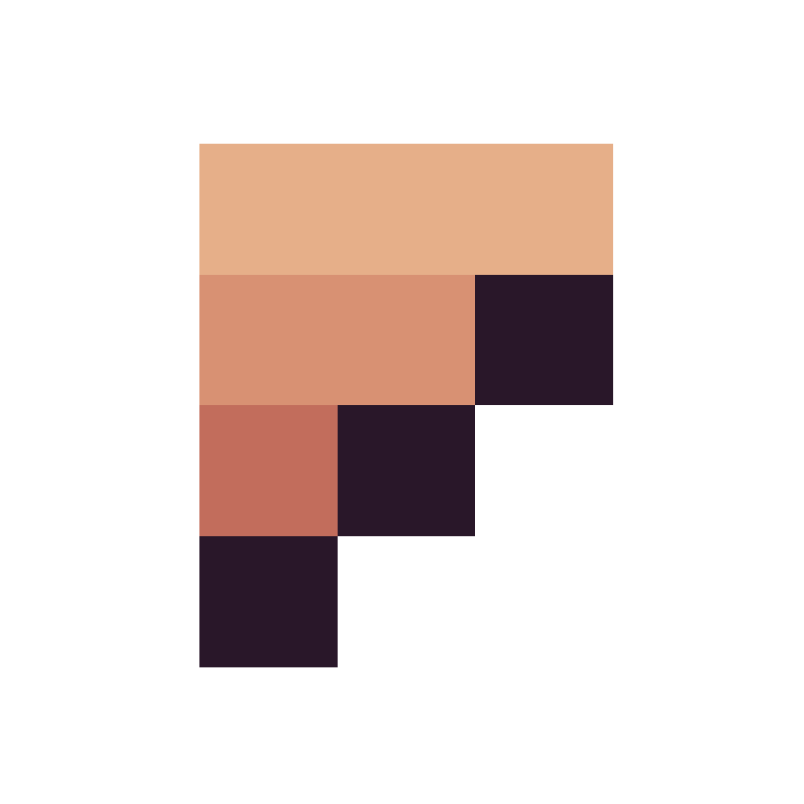

<p align="center">
  
</p>


# 
**Fizzy** is a cross-platform open-source modular general editor written in [Zig](https://github.com/ziglang/zig).

### Try it in your browser [here](https://fizzyed.it/app/)
### Downloads are available at the website [here](https://fizzyed.it)

[](https://ko-fi.com/R5R4LL2PJ)

### Note: This project, while started without AI years ago, is now heavily driven by AI development. I intend for that to be transparent, and that any mistakes or code quality issues be brought forward through issues. I realize this is controversial, and respect your decision to avoid this software if you disagree with how it is being created. 

If you would like to learn how AI is being used on this project, there will be a description of the current system at the bottom of this readme. 

Fizzy is an empty modular editor shell, which dynamically loads and unloads compiled plugins to provide editor functionality. It includes a store where plugins can be published as well as a store tab to browse and install these plugins.

Fizzy currently offers multiple ways for an application to be created, taking advantage of its windowing or other features.

1. a plain DVUI app just using the fizzy backend for windowing
2. a fizzy application, which can take advantage of plugins/store
3. a fizzy plugin

Fizzy gets built for its target platforms for releases, and comes as a fully installable and signed application. It ships with nothing but simple text editing and image viewing capabilities, and markdown support so store items can display READMEs. An application can opt not to include these default plugins, or make use of embedded plugins without plugin loading/updating/watching for hot reload.

Fizzy offers a SDK for developing plugins and several plugins already exist that can be installed, which are part of the fizzyedit org. These plugins will always be primary to the development of fizzy and used to exercise the plugin SDK and abilities of the editor.

- [pixi](https://github.com/fizzyedit/pixi) - Pixel art editor. Provides a grid structure for editing and creating animation frames, making use of Lospec palettes, and packing sprites into an atlas. This plugin uses its own workflow, and draws its cursors using its atlas. 
- [zig](https://github.com/fizzyedit/zig) - Zig language plugin, providing syntax highlighting and ZLS functionality (if compatible ZLS is in PATH) (hover/goto definition/signature help). The builtin `text` plugin is what this works alongside
- [ghostty](https://github.com/fizzyedit/ghostty) - Plugin adding only a bottom panel, which uses `ghostty_vt` to provide a cross-platform terminal.
- [chat](https://github.com/fizzyedit/chat) - Communication made generic, and compatible with agents
- [agent](https://github.com/fizzyedit/agent) - have an agent drive fizzy over MCP
- [atlas](https://github.com/fizzyedit/atlas) - Obsidian-styled markdown links and backlinks, and an interactive map for document links

## Minimal app measurements

The [measurement job](https://github.com/fizzyedit/fizzy/actions/workflows/hello-numbers.yml)
records example-app's minimal shape on macOS and Linux in ReleaseFast and ReleaseSmall.
Download `hello-numbers-<OS>-<arch>` from a run for the exact JSON lines and source revisions.

| Linux x86_64, example-app minimal | ReleaseFast | ReleaseSmall |
| --- | --- | --- |
| Stripped executable | 22,466,776 B | 14,854,952 B |
| Gzipped wasm | 4,137,331 B | 3,348,122 B |
| Installer, first frame, idle RSS after 30 s | [`installer_bytes`, `first_frame_ms`, `idle_rss_bytes` in the JSONL artifacts](https://github.com/fizzyedit/fizzy/actions/workflows/hello-numbers.yml) | same |

See the [method and manual Electron/Tauri comparison](docs/HELLO_NUMBERS.md) before comparing
samples: runner hardware, OS caches, packaged resources and startup clocks affect the results.

## User Interface
- The user interface is driven by [DVUI](https://github.com/david-vanderson/dvui).
- The general layout takes many ideas from VSCode or IDE's, as well as general project setup using folders.

## Compilation
- [Linux] Ensure `gtk+3-devel` or similar is installed (for native file dialogs).
- Install zig 0.17.0.
- Clone fizzy.
- Build.
    - ```git clone https://github.com/fizzyedit/fizzy.git```
    - ```cd fizzy```
    - ```zig build run```

## Credits
- [David Vanderson](https://github.com/david-vanderson) for all the help and [DVUI](https://github.com/david-vanderson/dvui).
- [emidoots](https://github.com/emidoots) for all the help and [mach](https://github.com/hexops/mach).
- [michal-z](https://github.com/michal-z) for all the help and [zig-gamedev](https://github.com/michal-z/zig-gamedev).
- [prime31](https://github.com/prime31) for all the help.
- Any and all contributors

## License

Fizzy is [MIT](LICENSE), and will stay free. Plugins and applications built on it may be
commercial and closed-source. What that promises, and what it asks, is in
[LICENSING.md](LICENSING.md); the name and logo are covered by [TRADEMARKS.md](TRADEMARKS.md).

## AI usage

Fizzy, as an empty shell and application framework, is currently driven by human planning and 3 AI development teams, one each for Windows, Linux and macOS. Currently, one project manager agent communicates with myself, and orchestrates load balancing and efficiently distributing work to each team. Teams can currently be Claude, Codex or Gemini, and these rotate to try to maximise exposure. These agents' work are local to 3 machines I run at my home, and can drive the app through planned tapes/recordings, and capture directly from the app if needed for visually inspecting the app. 

Each team is required to be approved by the project manager to have their PRs merged. The project manager requires that each teams PR be reviewed by a separate team prior to marking it ready for CI, which must be green to merge, passing the test suite. The project manager is then required to run each one by me before they are merged. There are also superfans that are distributed to run each day, each focused on a specific case and inspecting the existing code. The primary one pretends to be a zig team member and references the std to look for code quality issues each day. 


